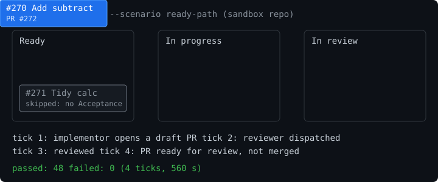

# fleet-board

## What it is

A Claude Code plugin that turns a GitHub issue board into a work queue for a fleet of coding agents, with hook-enforced human-QA and merge gates. An implementor writes failing tests first, a separate reviewer attacks the result, and a human merges.

## Demo



One card goes from Ready to a PR ready for review in four ticks on a sandbox repo. The terminal recording is [`plugins/fleet-board/docs/demo.cast`](plugins/fleet-board/docs/demo.cast); play it with `asciinema play plugins/fleet-board/docs/demo.cast`.

**Why it is built this way.** Cards are the state, tests come before code, a different agent reviews, and gates are hooks rather than requests. The reasoning is in the [design write-up](docs/design.md).

## Results

From the recorded run (`tests/behavioral-tick.sh --scenario ready-path`):

- 4 ticks, 560 seconds, one card (Add subtract) taken from Ready to a PR ready for review, and not merged.
- 48 checks passed, 0 failed.
- A second card with no Acceptance section was skipped rather than guessed at.

## Install

Tell Claude Code:

> Go to https://github.com/drothschild/fleet-board and follow the install directions.

Claude does the rest. The one step it cannot do for you is logging in to GitHub, if you have never run `gh auth login`.

To install by hand instead, run these in Claude Code and start a new session:

```
/plugin marketplace add drothschild/fleet-board
/plugin install fleet-board@fleet-board
```

### Install directions for Claude

Follow these steps in order, running each command with your shell tool. fleet-board needs only `git`, `jq` and `gh`; do not install anything else.

1. **Check the tools.** Run `git --version`, `jq --version` and `gh --version`. `git` and `jq` ship with macOS 15 and later. For each one missing:
   - with Homebrew (`command -v brew` succeeds), run `brew install <tool>` yourself;
   - otherwise give the user the install command for their system (for example `sudo apt-get install -y <tool>`), since it needs their password, and wait for them.
2. **Install the plugin:**

   ```bash
   claude plugin marketplace add drothschild/fleet-board
   claude plugin install fleet-board@fleet-board
   ```

   If the marketplace is already added, run `claude plugin marketplace update fleet-board` and continue.
3. **Check the GitHub login.** Run `gh auth status`. If it reports no login, ask the user to run `gh auth login` in a terminal and choose the browser login; it is interactive, so do not run it yourself. Scopes are checked later by `/fleet-board:init`.
4. **Finish.** Tell the user that fleet-board is installed, that it loads in a **new** Claude Code session, and that the next step is to open that session in the repository they want to manage and run `/fleet-board:init`. Point them to the [plugin README](plugins/fleet-board/README.md) for a first-hour walkthrough.

Everything else is in the [plugin README](plugins/fleet-board/README.md): requirements, a first-hour walkthrough on a fresh repo, [adding fleet-board to an existing project](plugins/fleet-board/README.md#adding-fleet-board-to-an-existing-project), the config reference and the gates.

## Provenance: how the agents were written (clean-room)

I wrote the specs and the verification process, and the audit trail shows the prompts are my design: the agents' prompt files were produced from those specs in isolated runs, and every run was checked.

The four agents (manager, implementor, reviewer, fixer) and four of the five skills (`reporting`, `tick`, `run`, `status`) were written **clean-room**. Here, that means the model that wrote each file could see only a written description of what the file must do, never another plugin's prompts or code.

How it was done:

- **Behavior specs first.** Each file has a spec saying what the agent or skill must do. The specs were written from a short brief, the design document and the notes of the process as it was first run by hand.
- **One isolated run per file.** Each spec and each prompt file was produced by its own `claude -p --bare` run, started with an empty Claude config directory so that no installed plugins, skills or personal instructions were loaded. Each run could read only its inputs: a prompt file could read its spec, and nothing else.
- **Every run checked.** Each run's startup record was checked to confirm that only Claude Code's built-in plugins were present, and that the run read and wrote only the files it was allowed to.
- **Changes the same way.** Later fixes did not regenerate the files. An isolated run edited the existing file in place, and the diff was checked to touch only the intended lines.

Why bother: the test-first, adversarial-review process fleet-board encodes is common practice, and other plugins encode similar processes. Writing the prompts from specs, in sessions that couldn't see any of that material, keeps fleet-board's prompts its own work rather than a derivative of someone else's.

None of this is needed to use the plugin. For checking it, the specs, the briefs they were written from, and a record of every authoring run (inputs, isolation checks, costs and file hashes) are in [`docs/implementation-plans/2026-09-28-fleet-board/specs/`](docs/implementation-plans/2026-09-28-fleet-board/specs/README.md). The `init` skill and the shell scripts were written directly and are not part of that record.

MIT licensed.
