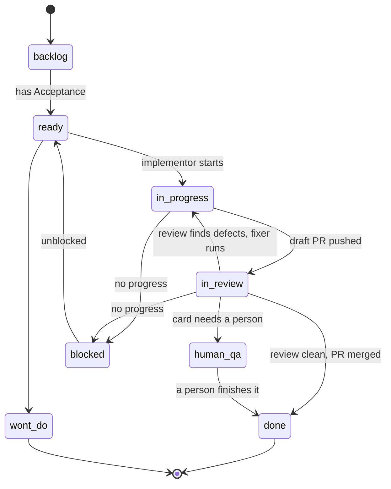

# The tradeoffs behind fleet-board

fleet-board turns a GitHub issue board into a work queue for coding agents. A manager advances cards, role agents (implementor, reviewer, fixer) do the work in git worktrees, and a hook enforces the human gates. This document covers the decisions that are not obvious from the code, each with the alternative I considered and the reason I chose what I did.

## The card state machine

Everything below is a decision about how cards move through this graph, and who is allowed to move them.

## One step per card per tick

The manager runs a tick: it reads the board, plans one action for each card, performs it, and exits. A card advances at most one step per tick. The next tick starts from the board, not from memory.

Alternative: a long-running manager that holds a card in memory and drives it from Ready to Done in one session, looping until the work finishes.

Because the manager keeps no state of its own, it is restartable: kill it at any point and the next tick picks up from what the board says. It is inspectable, since the plan for a tick is a single JSON document produced by one decision table, which can be read and tested offline. And the blast radius is bounded: a confused manager can do one wrong thing to each card, and the failure counter stops it repeating the same wrong thing. A long-running manager would be faster per card, but a hung or drifting session would take every in-flight card with it, and its state could not be examined from outside.

## Role agents never move cards

Implementors, reviewers and fixers do their work and post a report on the card. They never change a card's column. Only the manager moves cards, and it does so from the report.

Alternative: let each agent move its own card when it finishes, so the board always reflects the latest truth with no middleman.

Reason for the choice: a single writer of state is far easier to reason about than four. Reports are checked by a parser before they are posted, so a malformed report is rejected and the card stays put instead of landing in the wrong column. An agent that is wrong about its own work, or that has been steered by hostile text in a card, can say whatever it likes in its report, but it cannot promote itself. The cost is one extra hop per transition, which the one-step-per-tick rule already makes cheap.

## The manager note is the only persistent state

The manager keeps exactly one piece of durable state: a note stored as a comment on the card. It starts with a marker and holds one fenced JSON block: the PR number, branch, worktree, round count and failure counters.

Alternative: a local state file or database on the machine running the manager, which is faster to read and does not clutter the card.

Because the card is already the shared, durable, human-visible place where the work lives. State stored on the card survives a lost laptop, can be read by anyone looking at the card, and cannot drift away from the card it describes. The price is a trust boundary: anyone who can comment on the issue can post something that looks like a note. So only a marker comment authored by the authenticated login counts. Fields that later steer shell commands, such as the branch, the worktree path and the PR number, are validated against strict shapes before use: the branch must look like `fleet/<n>-<slug>`, the worktree must be an absolute path inside the worktrees base, and the counters must be integers. An invalid note is treated as empty, and the writer refuses to overwrite a stored invalid note.

## Fail closed everywhere

When the system cannot tell whether something is safe or complete, it stops rather than guessing.

Alternative: fail open, on the theory that a stalled fleet is worse than an occasional mistake, and a human can clean up afterward.

Because the mistakes this system can make are expensive and sometimes irreversible: a merge, a card pushed past a human gate, a command run from a forged note. A stalled card costs a retry. Three places show the pattern. The gate hook blocks any command it cannot parse. The `list` verb fails when the reply has exactly as many items as the requested limit, because the listing may be truncated and a missing card would be silently ignored. And an invalid note is treated as empty, never as partly trusted. Each of these makes the system noisier, and occasionally it blocks something harmless. I accept that: the noise is visible, whereas an open failure would be invisible until it did damage.

## The gate is a text check, with branch protection behind it

A PreToolUse hook reads the text of each shell command an agent is about to run. It blocks moving a card out of human QA, blocks merging when policy says a human merges, and blocks moving a card to Ready without an Acceptance section.

Alternative: a sandbox or proxy that enforces the same rules at the process or network level, where the agent cannot route around it by changing how a command is written.

Reason for the choice: a sandbox is the stronger tool, but it is also heavy to install, differs by platform, and a plugin cannot assume it. A text check works wherever Claude Code does and fails closed on anything it cannot resolve. It also has honest limits. It cannot see a script run from a file, another HTTP client, a push that merges, or deliberate obfuscation. Those residual bypasses are listed rather than denied. So the hook is a guard against agent mistakes and confused instructions, not a security boundary against a determined adversary. The real backstop is branch protection on the repository: required checks and required review are enforced by GitHub, no matter what any agent types.

## Evidence-based review

A reviewer does not read a diff and give an opinion. It produces evidence that can be re-executed. It maps every Acceptance bullet to a named test or marks it unmapped. It runs mutation testing on the changed code to see whether the tests notice when behavior is broken. It re-executes one claim from the implementor's report and records whether the output matches. In the second round it also checks that no existing test was weakened, skipped or deleted to get green.

Alternative: a reviewer that reads the code and judges it, which is cheaper and is how most human review works.

Because an agent reviewing an agent's work is persuaded easily by confident prose, and tests that pass prove little if they would also pass on broken code. Mutation testing makes that gap concrete. On HMB Workout, card 393 is the example: the reviewer's mutation run reported survivors, meaning changes to the implementation that the new tests did not catch. Every test passed, yet some of the behavior was not actually pinned down. A plain read-through would have called that card clean. The survivors went back to the fixer as findings, and the fix was to add assertions that killed them. The cost is time and compute on every review, and some mutants are equivalent or invalid and need to be counted separately, which is why the report separates killed, survived and invalid.

## Escalation and shared blind spots

When a card keeps failing review, the work escalates: after a bounded number of rounds, the card is blocked, and later skipped until a person clears it. Configuration also lets a different model take over the fixing.

Alternative: retry indefinitely with the same configuration, trusting that another attempt will eventually get through.

Reason for the choice: repeated attempts without progress are a signal, not a delay. The counter stops the loop and makes the card visible to a person. There is a subtler problem when the escalation model is the same as the reviewer's model. The writer then shares the reviewer's blind spots, so the review is checking work by something that thinks the same way and will miss the same things. The fleet therefore prints a warning when the two models are equal. It does not forbid it, because a small team may only have access to one model, but it makes the weaker guarantee explicit instead of hiding it.

## Human QA is a terminal state no agent can leave

Some cards need a person to look at the result, such as visual or product behavior no test describes. These go to the human QA column. Nothing automated moves a card out of it.

Alternative: allow an agent to move a card out of human QA once it judges the check complete, perhaps after attaching screenshots.

Because the whole point of the column is that the judgment cannot be delegated. If an agent could leave it, then the state would only be a pause, and a bug in any agent would turn into a skipped human check. Making it terminal for agents, enforced by the gate hook, means the guarantee does not depend on any agent behaving. The cost is that a card can sit there until someone has time. I judge that better than a card that quietly passes a check that never happened.

## Clean-room authoring

The agent definitions and the core skills were not hand-written. Each was authored by an isolated headless session with an empty configuration, working only from a behavior spec. The specs are the source of truth; to change an agent, change its spec and re-author it.

Alternative: write the agent prompts by hand, iterating in place, which is faster and more familiar.

Because hand-written prompts accumulate the author's assumptions and private context, and they can quietly depend on tools or files that exist only on one machine. A spec-first process forces the behavior to be written down, and a fresh session with no local setup shows whether the spec alone is enough. It also keeps the plugin portable. What it protects against is hidden coupling: a prompt that works only because of the author's own configuration. What it cost is real: slower iteration, a ceiling on API spend for each authoring run, a rule against hand-editing the generated files, and a harder time debugging when the output is slightly off. Specs get re-authored rather than patched.

## What I would do next

The weakest part is the gate, since a text check will always lag behind new ways of writing a command. The next step is to push more of those rules into repository settings, where they are enforced by the host, and keep the hook only as the early warning.
