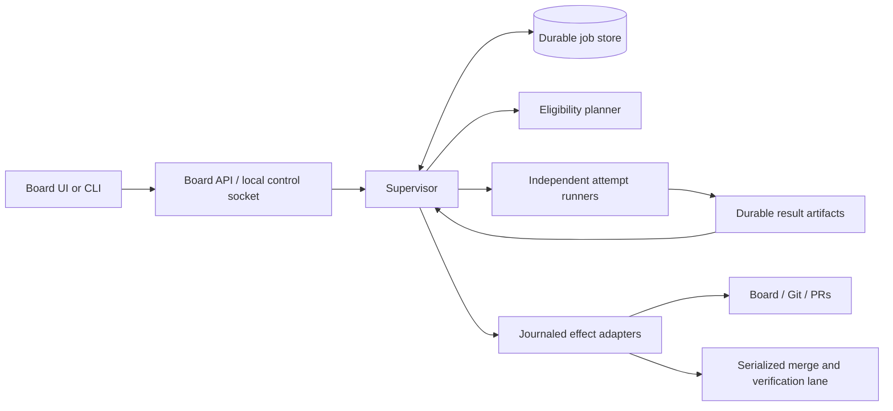

# Persistent Jobs and Supervisor Design

> **Superseded (2026-11-11)** by [`docs/superpowers/specs/2026-11-11-cli-supervisor-design.md`](../specs/2026-11-11-cli-supervisor-design.md). Kept for history; where they disagree, the new design wins.

## Summary

Replace tick-scoped execution with durable jobs and a persistent supervisor. A scheduling cycle reconciles results, advances eligible cards, claims capacity and scope, dispatches work, and returns without waiting for workers. Workers survive the initiating chat, browser, or tick. The supervisor recovers after crashes and reboot without duplicating work or silently resetting limits.

Status: design and implementation proposal based on the agreed discussion; no runtime implementation or service installation is included. Implementation details selected here (SQLite, module boundaries, numeric defaults, API shapes) make the agreed behavior concrete and reviewable.

## Definition of done

- A long or stuck worker cannot prevent unrelated cards from progressing through implementation, review, merge, and main verification.
- Jobs, attempts, reservations, operating intent, budgets, and effects survive controller restarts. Reconciliation never blindly repeats an external mutation.
- One automatic retry is allowed for a confirmed infrastructure interruption; repeated stalls and ambiguous effects require attention.
- Global/provider concurrency and one active attempt per card are enforced atomically. A separate merge lane serializes integration per repository.
- Scope remains reserved across review, CI, retry, and human-QA waits. An explicit human release on a safely paused card requires reacquisition and refresh before resumption.
- Board controls support Start, Pause scheduling, Resume, Stop after current work, and Stop now, with authoritative status and recoverable event history.
- `supervisor.start_on_boot` defaults to true. Automatic startup restores running/paused/stopped intent rather than granting fresh permission to work.
- Existing merge, exact-head review, human-QA, board-adapter, and clean-room contracts remain enforced.

## Glossary

- **Job:** one logical operation for a card and validated input version, such as reviewing a specific PR head.
- **Attempt:** one execution of a job. An infrastructure retry creates a new attempt, not a new job.
- **Reconciliation:** compare durable intent, worker evidence, and current external state, then safely record or advance state.
- **Generation:** monotonically increasing authority token for a job; superseded attempts cannot cause new effects.
- **Reservation:** card-owned claim on repository paths, independent of worker occupancy.
- **Run session:** durable accounting interval explicitly started by a human; process restart does not create a fresh allowance.
- **Effect:** journaled controller operation against Git, a board adapter, or another external system.

## Existing implementation and reuse

Baseline revalidated: main commit `db52f9f313adf2d6d5cd6c70c793296a13abb679` (2026-11-07), updated from original baseline `28866b0`. `board-web.py:start_run` already detaches `fleet-board-run.sh`. The manager can refill slots as completions arrive, but its transient registry requires every dispatched task to complete before the tick ends. Headless merges and wrapper budget checks occur after the tick. New cards are excluded from an already-running tick.

Reuse these existing boundaries:

| Existing component | New responsibility |
| --- | --- |
| `scripts/tick-plan.sh` | Read-only eligibility/action decision table; expose candidates without tick-local admission ordering |
| `scripts/board-*.sh`, `note.sh` | Board mutations and validated notes, invoked only by controller effect adapters |
| `scripts/merge-reviewed.sh`, `verify-main.sh` | Preserve exact-head merge checks, pending verification recovery, and literal `ok == true` |
| `scripts/settle.sh`, `review-stages.sh`, `cleanup-done.sh` | Extract bounded per-card operations rather than invoke whole-board drains in the event loop |
| `scripts/config.sh`, `config-defaults.json` | Validate and normalize new configuration |
| `scripts/board-web.py`, `scripts/board-web/static/*` | Proxy control requests and render supervisor snapshots/events |
| `scripts/claim-run-lock.py`, `fleet-board-run.sh` | Shared legacy/new ownership exclusion during migration |

Paths above are relative to `plugins/fleet-board/`. Current main has no `scripts/standalone/` controller. The local `codex/standalone-profiles` branch has journal/action prototypes, but they are not a merged production prerequisite. Implement against main; reuse separately reviewed work only after verifying its actual merged contracts. Do not assume a fixture worker is a production provider adapter.

### Main compatibility review (2026-11-07)

Two PRs merged after the original baseline; neither introduces a supervisor, changes the tick planner/merge contracts, or changes the seven-phase architecture:

- [PR #200](https://github.com/drothschild/fleet-board/pull/200), `bf5152e`: board summaries expose `known`, unknown states remain visible in an Unknown state group, and the drawer preserves the stored value until a person chooses a valid state. Preserve these API/rendering/edit behaviors when adding execution status. Unknown workflow state is distinct from supervisor unreachability or job attention: do not hide it, normalize it silently, or schedule it. Retain any existing execution/scope claims pending reconciliation.
- [PR #207](https://github.com/drothschild/fleet-board/pull/207), `db52f9f`: request body/time bounds, corrupt-card error reporting, temporary-file cleanup, atomic import metadata replacement, per-import create locks, created-card status, cached legacy log parsing, private run-file modes, and actual-listen-port card URLs are now existing behavior. Preserve these contracts in the supervisor proxy and legacy compatibility path; do not replace per-import locks with a global supervisor lock.

New reusable regression assets are `tests/test-board-unknown-interaction.sh`, `board-dom-harness.js`, `board-interaction-harness.js`, `board-unknown-interaction.js`, and `tests/test-board-web-atomic.sh` under `plugins/fleet-board/`. The DOM harness requires Node for those tests, not for the production supervisor. Existing `write_private_atomic` supplies atomic visibility for import metadata; it does not flush files/directories and therefore is not sufficient by itself for the design's crash-durable result/receipt protocol.

## Architecture and authority

Use Python's standard library for the durable controller, consistent with the existing Python board server, and Bash 3.2 wrappers for plugin entry points. New implementation lives in `scripts/supervisor/`: `store.py`, `models.py`, `scheduler.py`, `recovery.py`, `effects.py`, `workers.py`, `processes.py`, `service.py`, `cli.py`, and `boot.py`. A lightweight `runner.py` owns each provider process group, heartbeats, logs, and final result publication. `supervisor.sh` invokes the CLI. No third-party queue or database service is required.



Exactly one supervisor owns a board/repository domain. Resolve identity from canonical Git common directory plus board backend and stable board identity; linked worktrees cannot create independent schedulers for the same domain. A repository mutation lock also excludes supervisors targeting different boards on the same repository. Keep the legacy run-lock protocol compatible until migration is complete.

A host-held lock, not heartbeat expiry alone, controls supervisor ownership. A live but unhealthy owner must be stopped and its managed processes reconciled before takeover. Workers do not inherit the supervisor's ownership-lock descriptor. They run in separate sessions so supervisor loss does not implicitly kill them.

The board remains authoritative for card content, workflow state, and human approval. The job store is authoritative for execution, reservations, and accounting. Fresh board state is checked before every mutating effect. A human move into Human QA overrides any in-flight result: retain evidence, but never advance the card automatically.

Production admission requires a host-enforced worker boundary: deny access to the controller database/socket, board storage, shared repository metadata, Git credential files/helpers, SSH-agent sockets, keychain services, and ambient HOME credentials. Scrubbing environment variables and filesystem permissions for the same user are insufficient. Use a native macOS sandbox policy or Linux bubblewrap filesystem/process/network isolation, with capability probes and negative access tests on supported hosts; an unavailable or ineffective backend fails closed. Provider authentication passes through a minimal inference-only broker channel, with no arbitrary HTTP forwarding, publication route, controller socket, or host credential access. Worker copies have private Git metadata; controller publication imports validated artifacts. Any required setup/network access is a separately authorized bounded controller operation. Bubblewrap provides namespace primitives but requires an explicit restrictive policy. [Bubblewrap documentation](https://github.com/containers/bubblewrap/blob/main/README.md).

Workers receive scoped workspace access and produce result artifacts. They have no board/merge publication authority or controller credential environment. Provider/model choice remains explicit per role. Implementor/fixer publication (commits/branches/PRs), report posting, and merge authorization are controller effects. This is a deliberate change from current role instructions and requires new runner contracts plus clean-room re-authoring, not merely detaching today's manager.

## Durable store and protocols

Store state under `${FLEET_BOARD_LOG_DIR:-$HOME/.fleet-board}/supervisor/<domain-id>/`, outside plugin installations. Use a local SQLite database, private permissions, foreign keys, schema versions, WAL, and full synchronous durability. Use the database backup API for live backups; never copy just a live database file. WAL requires processes on the same host and is unsuitable for a network filesystem. [SQLite WAL documentation](https://www.sqlite.org/wal.html).

Minimal records:

| Record | Required fields and constraints |
| --- | --- |
| `domain` | identity, canonical root/common-dir, desired mode, lifecycle phase, revision, config hash, service version |
| `sessions` | ID, start time, deadline, known spend, unknown-spend flag, budget stop reason; restored across restarts |
| `jobs` | ID, card, action/role/stage/round, input SHA, input state revision, generation, state, eligible-since, priority, automatic retries used |
| `attempts` | ID, job/generation, provider/model, launch nonce, state, host boot identity, process identity, worktree, started/deadline timestamps, heartbeat/progress, exit/result reference, cancellation reason |
| `claims` | card ownership, global/provider slot, reserved normalized path and reservation revision, merge lane; transactionally acquired |
| `effects` | unique operation key, card/job/generation, input preconditions, intent, observed result, status, recovery evidence |
| `commands` | request ID, expected revision, actor, command, durable outcome |
| `events` | monotonically increasing sequence, timestamp, domain/card/attempt, event type, safe structured payload |

Job identity includes the logical input version so repeated planner cycles cannot reset retry counts. A new PR head can require a new review job, but a stalled unchanged operation cannot manufacture a new job to evade its cap. Retain exhausted-job tombstones until an explicit human retry/reset or validated new input justifies new work.

Attempt states: `prepared -> launching -> running -> result_ready -> reconciled`; exceptional paths enter `cancel_requested`, `interrupted`, `failed`, or `quarantined`. A result-ready process that has not exited still holds its execution claim. Jobs can be `queued`, `active`, `retry_wait`, `succeeded`, `failed`, `cancelled`, or `needs_attention`. Waiting reasons are separate structured fields, not overloaded status strings.

Launch protocol: atomically claim capacity/scope and persist attempt intent; launch a runner with a unique nonce; the runner atomically claims that attempt's execution lock and registers process identity before starting provider work. Duplicate launches with the same attempt identity cannot both execute. A separate runner receipt survives the gap between OS process creation and database acknowledgement. On ambiguous launch, reconcile registration/receipt/lock and process identity before any retry.

Before publishing a result, the trusted runner ingests referenced reports, logs, and checkpoints into a private attempt-owned durable artifact directory, flushes files/directories, and records hashes. References cannot point into provider scratch directories or mutable workspaces; reject escaping symlinks and changed files during ingestion. Retention/cleanup waits for durable ingestion and reconciliation, preserves uncertain or pending-QA evidence, and never deletes the only recovery artifact. The runner atomically publishes a versioned result file (temporary write, flush, rename, directory durability) and completion receipt before notification. Envelope: `schema_version`, `domain_id`, `job_id`, `attempt_id`, `generation`, `input_sha`, `role`, `stage`, `outcome`, `report_path`, `artifact_hashes`, `usage`, `exit_code`. Validate path containment, size, schema, report format, input identity, and generation. Duplicate notifications are harmless. A stale result is retained as evidence but cannot mutate the board or count usage twice.

## Recovery and external effects

Startup first acquires ownership, loads desired state, verifies/migrates schema, restores session limits, scans unfinished attempts/effects, and only then opens admissions. One ambiguous card need not stop independent work; ambiguity in repository-wide ownership or merge verification does.

| Observation | Recovery action |
| --- | --- |
| Durable result not reconciled | Validate and apply through journaled effects |
| Matching runner alive | Adopt monitoring without launching another attempt |
| Prepared launch demonstrably never executed | Resume launch with the same attempt identity |
| Worker absent, no result | Mark interrupted; consider the single retry after checking effects/workspace |
| Process identity ambiguous, survivors possible | Quarantine, retain occupancy and conflicting scope, request attention |
| Host boot changed | Old processes cannot survive that boot; reconcile durable results and external effects before retry |
| Store corrupt or unsupported schema | Fail closed with diagnostics; do not reconstruct authority from UI markers |

External effects cannot be atomically committed with SQLite. Record intent before invoking an adapter; observe and record its result after. Before replay, inspect the external system. Use unique operation markers where supported, fresh PR/head checks, and idempotent reads. Ambiguous non-idempotent effects require attention rather than a claim of exactly-once execution.

Examples: a merge intent binds PR and head. After a crash, read the actual merged state/commit and resume main verification; never blindly merge again. A posted report has a controller-owned operation identity; recovery finds an existing matching post before posting. Board move and note updates are separate effects with reconciliation between them. A moved or deleted card, changed head, changed scope, or changed approval invalidates old preconditions.

All adapter calls have deadlines and run outside the event loop as monitored operations. Network stalls in a planner, board write, verification, or cleanup cannot freeze health/control endpoints. Only one mutation chain may run for a card. Repository-wide verification failure closes merges and new admissions, preserves evidence, and reconciles already-running results without starting continuations.

## Stuck workers and retry policy

Track runner liveness, semantic progress, and absolute deadline separately. Heartbeats do not reset progress timers. Repeated log lines are not progress. Provider adapters report structured milestones (completed tool operation, checkpoint, recognized long-running operation); silence is not by itself proof of failure.

A stale heartbeat or progress threshold enters `suspected_stuck`: inspect runner/process identity and current bounded tool activity. An identified healthy long tool may continue until its original hard deadline. A confirmed stall, absolute deadline, or explicit cancellation follows: persist cancellation and revoke generation authority; request graceful shutdown; after grace terminate the managed process group; verify all managed descendants are gone; retain artifacts; release claims only when safe. Use boot ID plus process-start identity and nonce, never a PID alone.

Provider adapters must keep subprocesses in tracked containment. Escaped/unverifiable descendants quarantine the attempt; fencing alone cannot stop their filesystem writes. Do not reuse its workspace or release conflicting scope while it may still write.

Allow exactly one automatic retry per logical job, with backoff, for confirmed recoverable infrastructure interruption and no ambiguous effects. A first confirmed stall may retry only when classified as infrastructure failure; unexplained stalls, repeated stalls, invalid reports, policy failures, and uncertain publication require attention. Existing review/fix rounds and provider transport retries remain separately bounded and visible; supervisor retries must not multiply hidden whole-job retries.

Intentional cancellation neither spends the infrastructure retry allowance nor triggers automatic restart. Interrupted work is not retried while domain/card is paused or stopped. The retry uses preserved checkpoints only after validating workspace integrity and reconciling effects; otherwise create a clean workspace and retain the old one as evidence.

## Scheduling, concurrency, and fairness

Completion, board-change notice, control command, retry deadline, and periodic timer trigger a bounded reconciliation cycle. Notifications are hints; periodic scans recover missed events and discover external board changes. Coalesce triggers. No cycle waits for worker completion. Slow planning is an asynchronous bounded read; admissions validate current state and snapshot revision before claiming resources.

Capacity claims are transactional: global `limits.concurrency`, optional per-provider caps, one active attempt/mutation chain per card, required scope, and merge lane availability. Count controller-launched expensive verification/build attempts toward global execution capacity too. Lightweight metadata effects have a separate bounded control-operation pool so capacity saturation cannot prevent cancellation or result recording. Lowering a limit admits no new work until usage falls below it; it does not kill existing workers.

Prefer continuations, fixes, and reviews over new starts. Within classes use explicit card priority (proposed labels `fleet:priority:high|normal|low`, absent means normal; conflicting labels require attention), eligible waiting age, then card number. Order priority as a finite combined rank of work class and explicit card priority. Every `aging_seconds`, promote a continuously eligible candidate one combined rank, eventually reaching the highest rank regardless of original class or priority. At equal effective rank, oldest original eligible sequence wins, then card number; preserve that sequence across replans and restart. A stream of newly arriving high-priority reviews therefore cannot indefinitely outrank an old eligible start. Capacity/scope-ineligible cards cannot block fitting candidates. Progress is guaranteed only while capacity and required scopes become available; aging does not override safety reservations.

Hold one merge lane per repository through merge and verification, using `merge-reviewed.sh` checks and lock semantics. Refactor its drain into a bounded candidate operation. Pending verification is recovered before another merge. A card can reach this lane while unrelated implementation runs. Refresh plans after integration; dependency and exact-head review checks remain authoritative.

Run-session time and known spend persist across restart. Check deadlines on timers, not only between cycles. At the time limit, stop admissions and cancel active execution under the normal grace protocol. At the cost limit, close admissions and request cancellation; in-flight/provider-delayed charges may overshoot, which must be reported. Unknown usage remains unknown, never fabricated as zero; stop new paid admissions pending explicit resolution. A Resume preserves session accounting. Starting after an explicitly stopped/finished session creates a new session only through an explicit Start command.

## Scope reservations and human release

Reserve normalized repo-relative declared paths before first execution, then union verified actual changed files. Prefix overlap is path-boundary aware; reject traversal and resolve symlink escapes. Empty/unknown write scope is conservative repository-wide ownership until narrowed, not permission to edit anything without a claim. Missing/truncated actual file lists hold new potentially conflicting admissions.

Reservations belong to the card/change lifecycle: retain them across implementation, review, fix, CI, Human QA, pause, infrastructure retry, and safe process shutdown. Release after verified completion, explicit abandonment with no writers, or the human override below. Scope paths cannot shrink merely because a later plan omits them.

Before editing outside its reservation, a worker requests expansion. The controller grants only a nonconflicting transactional expansion. If denied, checkpoint and end the attempt as scope-waiting (no automatic-retry penalty), preserving owned paths. The card waits without a worker slot. Cyclic expansion waits become visible attention conditions; a human can pause/release one card. A provider unable to mediate writes must receive repository-wide scope or a verified filesystem write boundary; prompt-only requests do not establish enforcement. Detecting undeclared changes after execution quarantines the result and prevents publication.

`Pause card` closes its admissions; active attempts drain or can be explicitly cancelled. `Release reservations` requires explicit human command, paused card, no live/uncertain writers, no pending mutation/merge, and expected reservation revision. Record actor, reason, released paths, and time. Release changes neither board workflow nor Human-QA approval.

Resume reacquires the union of declared and actual scope, refreshes/rebases the branch through a journaled operation, resolves conflicts through attention, and invalidates affected review/test evidence. No worker starts before refresh and validation complete. A card still in Human QA remains there until the existing explicit human acceptance path authorizes advancement; reservation release/resume is never that acceptance.

## Configuration and startup

Agreed default:

```yaml
supervisor:
  start_on_boot: true
```

Proposed operational defaults (validated in `config.sh`, editable in YAML):

```yaml
supervisor:
  start_on_boot: true
  reconcile_interval_seconds: 5
  heartbeat_interval_seconds: 10
  heartbeat_timeout_seconds: 60
  progress_timeout_seconds: 900
  attempt_timeout_seconds: 7200
  shutdown_grace_seconds: 30
  retry_backoff_seconds: 60
  aging_seconds: 900
  provider_concurrency: {}
```

All durations are positive integers; heartbeat timeout exceeds heartbeat interval, attempt timeout exceeds shutdown grace; provider caps are positive integers referencing configured providers or reserved `claude` identity for built-in roles. One automatic retry is a fixed policy, not an uncapped YAML knob. A role/provider's existing smaller hard timeout still applies. Role-specific structured long-operation signals avoid pretending all tasks have identical progress behavior.

Reuse `limits.concurrency`, `max_hours`, `max_cost_usd`, `max_turns`, rate-limit margins/waits, and shared token staggering. Rate-limit waits consume no worker slot once a provider attempt has ended. Persist wait caps and launch rate-limit timestamps; `min_tick_gap` becomes minimum provider session-start spacing. Legacy `tick_interval` applies only in legacy mode; supervisor uses its own reconciliation interval. `max_consecutive_failures` bounds consecutive supervisor planning/control failures, closing admissions without erasing job state. Report unknown legacy configuration rather than silently reinterpret unrelated fields.

Configuration reload is validated and atomic. Invalid edits retain the last valid runtime config, display an error, and close new admissions until corrected. Existing attempts retain captured deadlines/model contracts. Startup reads YAML before admission; an unavailable repository/config causes a recoverable service wait, not a new empty board. Boot-time missing credentials produce waiting/attention status and no paid dispatch.

### OS service behavior

Persist desired mode (`running`, `paused`, `stopped`) separately from observed lifecycle (`starting`, `recovering`, `running`, `draining`, `cancelling`, `stopped`, `unreachable`, `error`). First installation initializes stopped: default boot recovery does not authorize work on a never-started board.

A stable installed launcher outside the versioned plugin cache reads a per-user domain registry and current YAML. Service setup is explicit and idempotent; a YAML value alone cannot install an OS service. Before setup, UI reports `boot_registration: missing`; never claim reboot recovery is active. Store executable paths and environment references without secrets; missing/moved executables are visible errors. Updates must preserve/reconcile active runner protocol versions.

For macOS, true boot-before-login requires a LaunchDaemon configured to run as the owning unprivileged user, with installation requiring administrator authorization. A LaunchAgent starts with user login and is only an explicitly labeled fallback, not satisfaction of boot-before-login. Credentials and encrypted home/repository availability can delay usable execution. [Apple launchd lifecycle documentation](https://developer.apple.com/library/archive/documentation/MacOSX/Conceptual/BPSystemStartup/Chapters/CreatingLaunchdJobs.html).

For Linux, use a user systemd service with lingering enabled for pre-login recovery; surface missing lingering/service registration rather than silently promising boot behavior. [systemd loginctl documentation](https://www.freedesktop.org/software/systemd/man/256/loginctl.html).

With `start_on_boot: true`, boot service restores running -> recovery then scheduling, paused -> recovery then paused, stopped -> remains stopped. With false, automatic boot activation does not start that domain; explicit Start still works, and crash recovery during the same explicitly started host session remains enabled. Persist host boot identity to distinguish crash restart from a reboot. Changing YAML while stopped is honored on the next boot/start because the installed bootstrap reads YAML rather than a stale copied flag. Service keep-alive never overrides stopped intent.

## UI and control contracts

Keep the board server as loopback HTTP frontend with existing Host/CSRF protections, 1 MiB request-body limit, and 30-second silent-client timeout; authenticate its private local control socket using filesystem ownership/permissions. A missing supervisor can be started by the lifecycle adapter, but UI/CLI cannot directly edit job tables. The stopped-state lifecycle adapter can persist Start intent under exclusive domain lock when no supervisor exists. Running-state commands route through the owner.

Derive actor identity from the authenticated local control channel and board-server session, never from a caller-supplied actor string. Worker IPC permits only its own heartbeat, progress, result and scope-expansion requests; it cannot issue lifecycle, resolution or reservation-release commands. Commands carry `{request_id, expected_revision, ...arguments}`. Deduplicate request IDs durably; stale revisions return 409 with current state. Accepted asynchronous commands return 202 with `{command_id, state_revision, desired_mode, phase}`; acknowledgement is not completion. Status is authoritative only after supervisor acknowledgement. Repeated Start requests connect to the existing owner without creating a second process/session.

| Endpoint | Contract |
| --- | --- |
| `GET /api/supervisor` | schema version, revision, desired/observed state, heartbeat freshness, session limits/usage, capacity, queue counts, config/boot registration status, last error |
| `POST /api/supervisor/start` | Ensure service, recover, enable scheduling; reconnect when already running; existing paused session resumes without budget reset |
| `POST /api/supervisor/pause` | Close worker/merge admissions, drain existing operations, record results; remains alive |
| `POST /api/supervisor/resume` | Refresh eligibility and resume same session; does not clear Human QA or budget stop |
| `POST /api/supervisor/stop` | Body `mode: drain|cancel`; persist stopped intent immediately, then finish/cancel active operations and shut down |
| `GET /api/supervisor/events?after=<sequence>&limit=<n>` | Durable ordered events, next cursor; bounded polling for v1; expired cursor returns snapshot-required response |
| `GET /api/cards/<n>/execution` | job/attempt state, progress, deadlines, retries, waiting reason, claims, safe log references |
| `POST /api/cards/<n>/execution/pause` | Pause admissions for this card; body chooses drain or cancel |
| `POST /api/cards/<n>/execution/release-reservations` | Human actor/reason and expected reservation revision; safe-release checks above |
| `POST /api/cards/<n>/execution/resolve` | Explicit human resolution: body `action: retry|record_usage|confirm_effect|abandon`, reason, evidence references and expected revision; safety checks below |
| `POST /api/cards/<n>/execution/resume` | Reacquire/refresh before dispatch; preserve existing workflow approval gates |

Resolution is separate from Resume. `retry` is an explicit manual attempt after confirming no possible old writer or unresolved effect; it does not reset the recorded automatic retry count or session budget. Further manual attempts each require a new audited command. `record_usage` records observed nonnegative usage and evidence for the named attempt, recomputes session totals and retains the original unknown-usage event; it cannot clear a budget stop or silently write zero for missing evidence. `confirm_effect` asks the controller to verify supplied external evidence against actual state before resolving ambiguity, never trusts a human text assertion as proof of a safe merge. `abandon` stops further work and releases claims only after writers/effects are safely resolved, preserving artifacts. Unverifiable process/effect state remains quarantined even after a command. None of these actions bypasses human QA, merge policy, current-head review, scope acquisition, or fresh validation. CLI `resolve --card <n> --action <action>` uses the same revision-bound protocol.

Retain `/api/run` as a compatibility status projection; `/api/run/start` delegates Start and `/api/run/stop` delegates drain-stop. No endpoint claims running merely because a spawn succeeded. While unreachable, show last known state with timestamp and unknown occupancy, not zero active jobs. Logs redact credentials and are served through validated IDs, never arbitrary filesystem paths.

UI status bar: desired mode/observed phase, occupied slots/global cap, per-provider occupancy, ready/running/waiting/attention counts, budget and boot status. Cards: activity, elapsed time, heartbeat and progress ages separately, retry count, exact wait reason (including blocking card/path), reservation state, logs/results. Timeline: launches, completions, retry decisions, cancellation, release overrides, recovery, and control actions. Durable cursors make refresh/reconnection lossless; compacted history triggers a full snapshot.

Pause is the primary everyday action; Stop menu offers drain/cancel. Drain means current attempts and already-started safe mutation chains only, not their follow-on review/fix/merge. Necessary verification of an already-merged commit continues as recovery work. Cancel does not interrupt an irreversible operation blindly: observe its outcome before shutting down; ambiguity remains needs-attention and cannot be advertised as cleanly stopped. Control intent remains stopped across a crash while draining/cancelling.

## Migration and operational boundaries

Introduce supervisor behind `supervisor.enabled: false` during implementation; final reviewed release switches default to true. `start_on_boot` defaults true throughout but requires registration. Old and new launchers share exclusion; never run both on one domain. Switching requires legacy workers to end or be explicitly cancelled/reconciled. Migrate manager notes and existing PRs into durable jobs/reservations without redispatching completed work; quarantine unidentified old processes. Keep a backup and schema-versioned migration log.

Manual tick becomes one bounded reconciliation request, returning launched/running/waiting counts and a cursor without awaiting completion. Run ensures supervisor scheduling is enabled; status reads durable state. Do not use `dispatchable: false` as proof the board is finished when jobs are active, waiting, or gated. Compatibility reporting explicitly distinguishes runnable, active, waiting-human, waiting-external, and quiescent.

Rollback disables new admissions, safely drains/cancels and settles pending effects, then enables the legacy launcher. Preserve store/evidence; never delete state or treat rollback as authorization to resume exhausted jobs. Cleanup follows verified terminal state and preserves pending-QA artifacts, uncertain workspaces, and recovery evidence.

Clean-room manager/role/tick/run/status changes require spec edits and an explicitly authorized isolated re-author run. Paid behavioral validation and OS service installation are separate execution gates. This documentation task performs neither.

## Acceptance criteria

| ID | Observable requirement |
| --- | --- |
| S1 | A stuck A does not delay B review/merge or admission of independent C; no tick waits for A |
| S2 | Chat/browser close and supervisor restart preserve active attempts without duplicates |
| S3 | Crash at every launch/result/effect boundary recovers or quarantines deterministically; stale results cannot mutate state |
| S4 | PID reuse, surviving descendants, unknown launch state, and unavailable board data never authorize unsafe retries/releases |
| S5 | One infrastructure retry maximum survives restarts; cancellation, semantic failures, and ambiguous effects do not auto-retry; manual resolutions are audited and cannot waive safety checks |
| S6 | Global/provider/card limits and merge lane hold under racing commands and limit changes; old eligible work ages fairly |
| S7 | Reservations survive all wait states; expansion conflicts block writes; human release/reacquisition preserves QA and review validity |
| S8 | Exact-head review, merge policy, CI, review stages, dependency rules, and main verification remain enforced |
| S9 | UI controls implement stated transitions, show unreachable honestly, and replay events without duplicate commands |
| S10 | YAML defaults boot true; running/paused/stopped intent and same-session budgets survive restart/reboot; false suppresses boot activation |
| S11 | Deadline/cost/config failures close admissions promptly while control/recovery remains responsive; unknown spend is visible |
| S12 | Legacy/new exclusion, migration/rollback, clean-room provenance, and supported-host startup validation are complete |

## Implementation phases

<!-- START_PHASE_1 -->
### Phase 1: Contracts, configuration, and store
**Goal:** Versioned durable state, validated settings, atomic claims, session accounting.
**Components:** new supervisor models/store; existing config scripts; focused store/config tests.
**Dependencies:** none.
**Done when:** S3/S5/S6/S10/S11 storage and configuration cases pass offline; default behavior remains legacy.
<!-- END_PHASE_1 -->
<!-- START_PHASE_2 -->
### Phase 2: Attempt runner and recovery
**Goal:** Independent execution, launch receipts, result durability, fencing, cancellation, retry.
**Components:** processes/runner/workers/recovery modules; fake worker fixtures.
**Dependencies:** Phase 1.
**Done when:** S2-S5 process/crash cases pass with real local fake processes and no provider calls.
<!-- END_PHASE_2 -->
<!-- START_PHASE_3 -->
### Phase 3: Scheduler and reservations
**Goal:** Bounded cycles, atomic capacity, fairness, scope lifetime and override protocol.
**Components:** scheduler module; candidate mode in tick-plan; reservation commands.
**Dependencies:** Phases 1-2.
**Done when:** S1/S6/S7/S11 scheduler cases pass under deterministic clocks and interleavings.
<!-- END_PHASE_3 -->
<!-- START_PHASE_4 -->
### Phase 4: Controller effects and provider integration
**Goal:** End-to-end card progression, safe publication, per-card merge/verification, bounded accounting.
**Components:** effects/workers adapters; existing report/settle/merge/verify helpers; role specs.
**Dependencies:** Phases 1-3.
**Done when:** S1/S3/S8/S11 offline lifecycle and effect fault-injection cases pass; production role activation remains gated on Phase 7.
<!-- END_PHASE_4 -->
<!-- START_PHASE_5 -->
### Phase 5: Service and board controls
**Goal:** Persistent service, CLI/local socket, UI status/commands/events and card controls.
**Components:** service/cli, supervisor.sh; board-web.py/static files; shared run-lock guard.
**Dependencies:** Phases 1-4.
**Done when:** S2/S9/S12 service/UI cases pass; fake workers survive UI/server closure.
<!-- END_PHASE_5 -->
<!-- START_PHASE_6 -->
### Phase 6: Boot integration and operational recovery
**Goal:** Stable launcher, registration diagnostics, boot/crash distinction, versioned upgrades.
**Components:** boot module and launchd/systemd templates; config/runtime documentation.
**Dependencies:** Phase 5.
**Done when:** S10-S12 mocked service tests pass and separately authorized host installation/reboot checks are recorded.
<!-- END_PHASE_6 -->
<!-- START_PHASE_7 -->
### Phase 7: Migration, clean-room contracts, and qualification
**Goal:** Reviewed default cutover with safe rollback and genuine production runner evidence.
**Components:** legacy wrapper transition, clean-room specs/re-author outputs, README/contracts, release manifests.
**Dependencies:** Phases 1-6.
**Done when:** S1-S12 coverage complete, independent review resolved, explicitly authorized behavioral/host checks passed, and migration/rollback rehearsed. Do not claim completion while an execution gate remains open.
<!-- END_PHASE_7 -->
